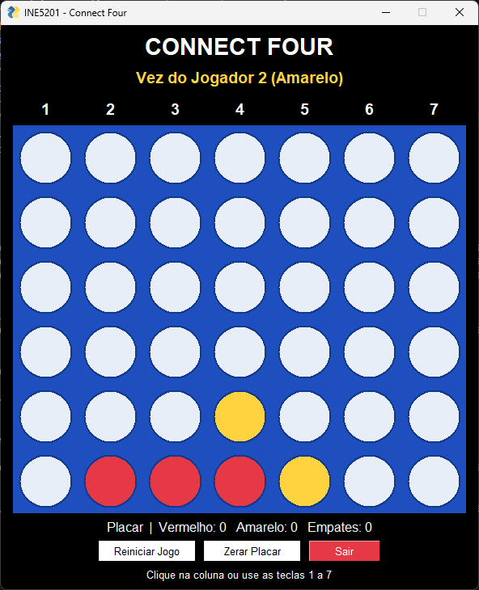
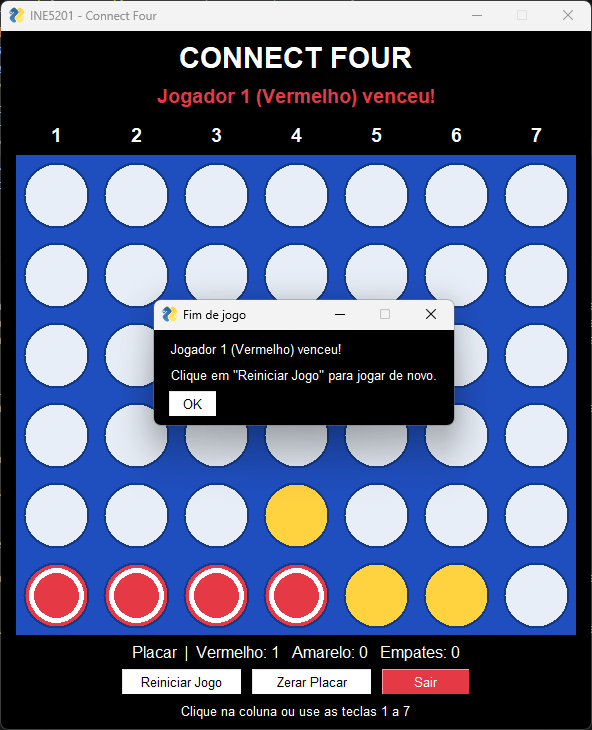
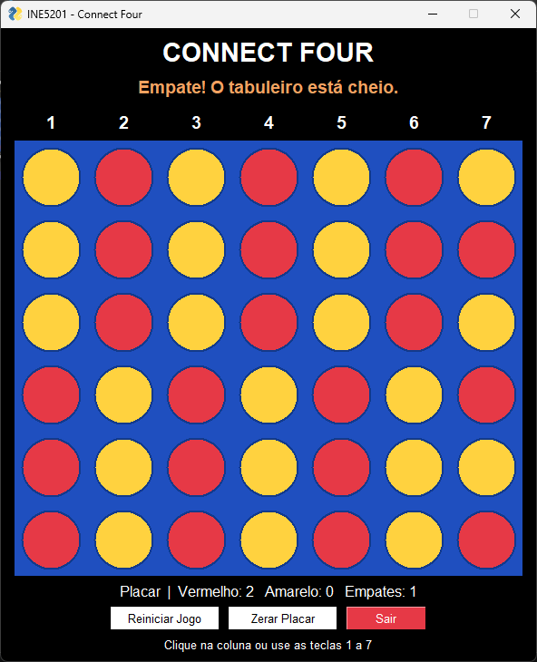

# Connect Four (Quatro em Linha)

Tarefa 01 da disciplina **INE5201 - Introdução à Ciência da Computação com Python** (UFSC), prof. Rafael Novo da Rosa.

Jogo Connect Four para dois jogadores com interface gráfica em Python, usando uma matriz 6 x 7 para representar o tabuleiro e a biblioteca FreeSimpleGUI para a janela.

## Dupla

| Nome | Matrícula |
|---|---|
| Matheus da Silva Farani | 24202994 |
| Paulo Ricardo Eliel Mendes Peres dos Santos | 24100434 |

## Como executar

Requisito: Python 3.10 ou mais recente.

```bash
pip install -r requirements.txt
python connect_four.py
```

## Como jogar

Os jogadores se alternam soltando fichas nas colunas. O Jogador 1 é o vermelho e o Jogador 2 é o amarelo. Para jogar, clique em qualquer ponto de uma coluna ou aperte as teclas 1 a 7. A ficha cai até a casa livre mais baixa. Vence quem alinhar 4 fichas da mesma cor na horizontal, na vertical ou em qualquer diagonal. Se o tabuleiro encher sem ninguém alinhar 4, a partida termina empatada.

## Funcionalidades

**Interface**
- Tabuleiro 7 colunas x 6 linhas desenhado em um `sg.Graph`, com os números das colunas no topo
- Jogada por clique na coluna ou pelas teclas 1 a 7
- Cores diferentes para cada jogador (vermelho e amarelo)
- Indicador de turno com o nome e a cor de quem joga
- Mensagem de vitória ou empate na janela e em popup, com as 4 fichas vencedoras destacadas por um anel branco
- Botão **Reiniciar Jogo**; quem começa alterna a cada partida
- Placar acumulado entre partidas e botão **Zerar Placar**

**Lógica**
- Gravidade: a ficha ocupa a casa vazia mais baixa da coluna
- Validação de coluna cheia: avisa o jogador e não passa a vez
- Detecção de vitória nas 4 direções (horizontal, vertical e as duas diagonais)
- Detecção de empate quando todas as colunas estão cheias
- Alternância de turnos; cliques depois do fim da partida são ignorados

## Estrutura do código

```
connect_four.py
├── Constantes: LINHAS, COLUNAS, cores, tamanhos, DIRECOES
├── Lógica do jogo
│   ├── criar_tabuleiro()
│   ├── coluna_cheia(tabuleiro, coluna)
│   ├── inserir_ficha(tabuleiro, coluna, jogador)
│   ├── verificar_vitoria(tabuleiro, jogador)
│   ├── tabuleiro_cheio(tabuleiro)
│   └── outro_jogador(jogador)
├── Interface gráfica
│   ├── desenhar_tabuleiro(window, tabuleiro, vencedoras)
│   ├── mostrar_status / mostrar_vez / mostrar_placar
│   ├── jogar(window, estado, placar, coluna)
│   ├── coluna_do_evento(event, values)
│   └── criar_janela()
└── main(): loop principal de eventos
```

**Representação do tabuleiro.** O tabuleiro é uma lista de listas com 6 linhas e 7 colunas. Cada casa vale `0` (vazia), `1` (Jogador 1) ou `2` (Jogador 2). A linha 0 é a do topo, por isso `inserir_ficha` percorre a coluna de baixo para cima (`range(5, -1, -1)`) até achar a primeira casa vazia.

**Detecção de vitória.** Em vez de escrever um laço para cada direção, `verificar_vitoria` usa a lista `DIRECOES` com os passos `(linha, coluna)` de cada direção: `(0, 1)` horizontal, `(1, 0)` vertical, `(1, 1)` e `(1, -1)` diagonais. Para cada casa e cada direção, o código monta as 4 posições seguidas e confere se todas estão dentro do tabuleiro e são do jogador. Quando acha, devolve essas 4 posições, que a interface usa para destacar a sequência vencedora.

**Coordenadas da janela.** O `sg.Graph` foi criado com `graph_bottom_left=(0, ALTURA)` e `graph_top_right=(LARGURA, 0)`, o que faz o eixo y crescer para baixo, igual aos índices da matriz. Assim, a coluna clicada é simplesmente `x // CELULA`.

## Screenshots

**Partida em andamento**



**Vitória com as fichas destacadas**



**Empate**



## Uso do GitHub Copilot

Usei o chat do GitHub Copilot no VS Code, no modo de perguntas, enquanto montava o projeto em etapas. Prompts usados:

| Prompt | Para que usei | O que aproveitei ou mudei |
|---|---|---|
| "Explique para que serve esta lista de direções em um jogo Connect Four" | Entender a lista `DIRECOES` | Entendi que cada par representa um passo na linha e na coluna. Não alterei o código. |
| "Sugira melhorias para esta função de inserção de ficha" | Avaliar a função `inserir_ficha` | Descartei o `raise ValueError` para coluna inválida e mantive o retorno `-1` em vez de `None`. |
| "Explique como funciona esta função verificar_vitoria" | Entender a detecção de vitória | Conferi a explicação com o código. Não alterei o código. |
| "Como mudar a cor de um botão no FreeSimpleGUI?" | Personalizar a interface | Aceitei a sugestão de `button_color` e usei no botão Sair, com o vermelho do jogo. |

**Relato.** O Copilot me ajudou principalmente a entender partes do código, como a lista `DIRECOES` e a função `verificar_vitoria`, que percorre cada casa e testa as quatro direções. Aceitei a sugestão de usar `button_color` e apliquei essa opção ao botão Sair para destacá-lo. Descartei a sugestão de lançar `ValueError` em `inserir_ficha` quando a coluna fosse inválida, porque a interface só gera colunas de 0 a 6 e esse erro fecharia o jogo em vez de orientar o jogador. Com isso, aprendi que uma sugestão pode estar correta de forma geral e, mesmo assim, não ser necessária no programa.

## Tecnologias

- Python 3
- [FreeSimpleGUI](https://pypi.org/project/FreeSimpleGUI/)
- GitHub Copilot
